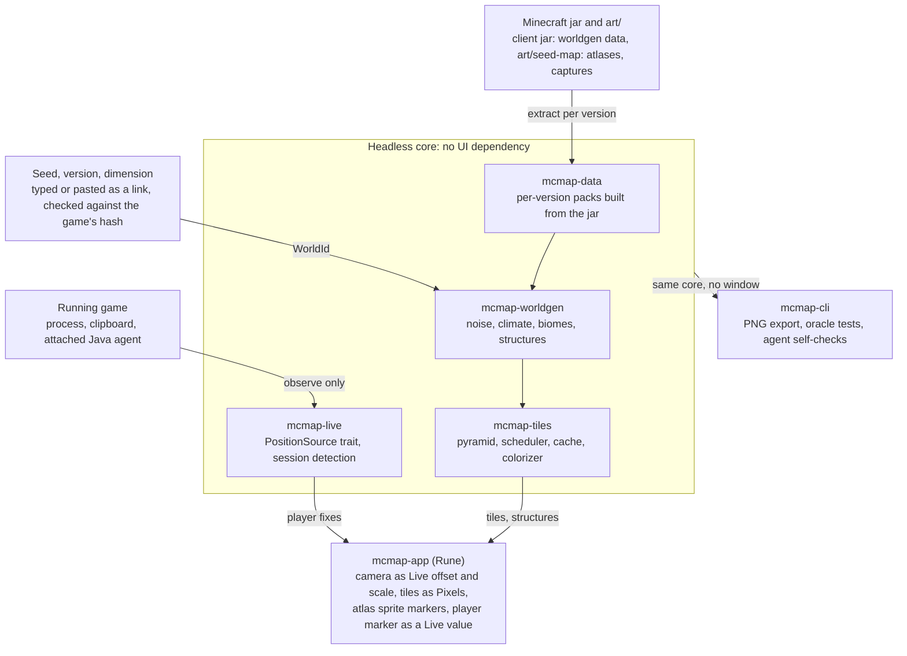

# MC Mapper: Rust seed map with live player — implementation plan

2026-11-09 · Living copy: <https://claude.ai/artifact/P4QumSwzg2jgjUeB3LD9gm>

## Summary

Build a Cargo workspace with three seams: a headless world-generation library, a Rune front end that draws biome tiles under a live camera, and a position-source interface that the live-player phase plugs into without touching either.

Four decisions shape everything else.

1. **Rune is the UI layer.** It is a native GPU UI framework from Anomaly, not the rune-rs scripting language. It has the three primitives a map needs: streamed RGBA images, a compositor-side camera, and background requests.
2. **World generation is data-driven and starts with 26.3.** One Rust interpreter evaluates Minecraft's own density-function and biome-parameter data, extracted from the jar already in your `~/.minecraft`. 26.3 computes in single precision and is ported from that jar. The game's own classes are the test oracle.
3. **Art comes from `art/seed-map/`.** The marker and feature atlases supply the icons, loaded through an asset-pack interface. The reference captures there become exact tests for biomes, palette and structures.
4. **Live position comes from a small Java agent inside the game.** You play on a Realm, where nothing outside the game process sees your position. The map attaches a read-only agent to the running game and receives 20 fixes a second over a localhost socket. F3+C through the clipboard is the fallback.

## Assets: what is in `art/seed-map/` and how it is used

The two sprite atlases give the map its look, and the three reference captures become the project's acceptance tests. I opened every file; the counts and measurements below are from the images themselves.

| File | What it holds | Use | Work needed |
| --- | --- | --- | --- |
| `map/marker-atlas.webp` | 69 map markers, mostly 26 px with a white outline, in an irregular layout | Structure and point-of-interest icons on the map | A crop table. The manifest has none for this atlas. |
| `ui/feature-atlas.webp` | 22 px icons on an 11 by 4 grid, 30 of them labeled in the manifest | Feature picker toggles | None. Crops are in `manifest.json`. |
| `ui/icon-mode-toggle.png` | One 16 by 22 px control | Show or hide icons | None. |
| `ui/button-atlas.png` | A 24 px wide strip of small monochrome glyphs in dark and light pairs | Toolbar glyphs | A crop table. |
| `ui/page-texture.png`, `ui/content-texture.png` | Tiling backgrounds, 6 px square and 157 by 130 px | Window and side-panel backgrounds, in M4 | Pre-tile into one image. Rune's docs show no repeat mode. |
| `reference/biomes.png` | Biome layer of the target view, 1133 by 566 px, 14 colors | Exact test for the biome core, and the palette source | Calibrated below. |
| `reference/features.png` | Transparent feature layer of the same view | Test for slime chunks and structure positions | Same calibration. |
| `reference/map-view.png` | The two layers composited | Visual target for the app's headless snapshot | None. |

### Loading

Rune decodes WebP and PNG natively but draws whole images. The app therefore decodes each atlas with the `image` crate, slices every sprite into its own RGBA buffer, and hands those to Rune's image cache.

The sprites are pixel art and Rune samples bilinearly. On a high-density display each sprite is enlarged by an integer factor with nearest-neighbor before upload. This is the same rule the tiles follow.

An `xtask atlas` command builds the two missing crop tables by segmenting each atlas on alpha. Labels are assigned once by hand and saved next to the manifest.

### What the reference captures pin down

The captures are precise enough to test against. Biome cells are exactly 5 px wide and slime chunks sit on a 20 px grid, so the view is 1.25 px per block. With the manifest's center, every pixel maps to a block coordinate.

- **Biomes:** about 25,000 cells of ground truth for 26.3, the version cubiomes cannot check.
- **Palette:** 9 of the 14 colors match the cubiomes table exactly, and a tenth matches the older Amidst value for taiga. The other 4 are learned from the capture once the generator labels those cells.
- **Structures:** the feature layer shows one ancient city, two trial chambers, two ruined portals and the slime chunks. The ancient city marker sits at about x 3128, z -1352.

### Keeping the art local

The manifest marks the atlases and textures as original files from Chunkbase. That works for a tool that stays on your machine. Keep `art/` out of any public repo or release. The asset-pack interface lets another icon set replace it if the app is ever shared.

## Rune: what it is and how it fits

[Rune](https://github.com/anomalyco/rune) is a pre-release, MIT-licensed, GPU-rendered Rust UI framework for macOS, Windows, Linux and the web. It has its own renderer on wgpu, Taffy layout, Parley text and spring animation. There are no releases; apps pin a rev of its `dev` branch.

It suits a map well because its docs describe a canvas camera as a first-class pattern. Your machine is Linux x64, which Rune supports.

| Map need | Rune primitive | Why it matters |
| --- | --- | --- |
| Tile images | `rune::Pixels` | Thread-safe RGBA image. `set()` from a worker uploads and wakes only windows showing it, with no view re-run. |
| Pan and zoom | `Live` values via `live_offset` and `live_scale`, with `tx.live_only()` | Camera moves skip view, diff and layout. Rune measures 2.0 ms against 13.7 ms CPU per frame on 6,000 elements. |
| Pointer input | `on_wheel`, `on_drag`, `on_magnify`, `on_pointer_move_local` | Points arrive in the element's own space under the camera, so hit-testing holds while zoomed. |
| Icons | `ImageCache::rgba` | Takes the sprites sliced from the atlases as RGBA. |
| Coordinates readout, player marker | `LiveText`, `Live<[f32; 2]>` | Updated from any thread without rebuilding the view. This is the live-player hook. |
| Search and seed changes | `rune::Latest` | Latest-wins background requests with debounce. |
| Verification | `--snap`, `--tree`, scripted input | Every app runs headless, so map goldens run in CI and an agent can check its own output. |

Three constraints shape the design.

- **Image sampling is bilinear only.** Magnified biome tiles would blur at the edges. The tile renderer therefore draws every zoom level at device resolution and never asks Rune to enlarge a tile.
- **The API is moving and Anomaly takes no pull requests.** Only one crate depends on Rune, and the rev is pinned. Replacing the UI layer later would not touch world generation or tiles.
- **Camera values are `f32`.** Minecraft coordinates reach 30 million blocks, past `f32` integer precision. The app keeps the camera in `f64` and rebases the drawn origin near the view.

Rune's compositor hook exposes the wgpu device and render pass. It is the escape hatch if a custom tile shader is ever needed.

## Architecture

The workspace is four headless library crates and two binaries. Only `mcmap-app` depends on Rune, and live position enters through one trait in `mcmap-live`.



The live crate never touches tiles or world generation. It only observes the game and emits player fixes, so it can be built and tested on its own.

### What the live phase requires of the map from day one

1. **World identity is a value.** `WorldId { seed, version, dimension, preset }` keys every cache and can change at runtime. The game will switch worlds and dimensions without the user touching the map.
2. **Coordinates are `f64` blocks end to end.** A player marker needs sub-block accuracy at any distance from origin.
3. **The camera has a follow mode from the first build.** Manual pan releases it and one key re-engages it.
4. **One path carries all cross-thread updates.** Tiles and positions both arrive from workers through `Pixels`, `Live` values and Rune's waker.
5. **A replay source ships with the first app build.** A recorded path file drives the marker in headless tests, so the seam is exercised before any real source exists.

### Crate choices

| Concern | Choice | Note |
| --- | --- | --- |
| UI | `rune`, `rune-kit` from git at a pinned rev | Used only by `mcmap-app`. |
| Art | `image` with PNG and WebP | Decodes the atlases, slices sprites, integer upscaling. Already in Rune's dependency tree. |
| Parallel tile work | `rayon` | Workers publish through `Pixels::set`. |
| Memory cache | `quick_cache` | Byte-budgeted, keyed by `WorldId`, level and tile. |
| Disk cache | Plain files with `zstd` | Stores biome IDs, not pixels. |
| Version packs | `serde_json` to read, `postcard` and `zstd` to store | Compiled once per game version. |
| Jar access | `zip` | Worldgen JSON from the local jar. |
| Process detection | `sysinfo` | Finds the running game, its directory and its Java runtime. |
| File watching | `notify` | The launcher's quick-play record. Saves and logs later. |
| Clipboard | `arboard` with its Wayland data-control feature | The F3+C source. |
| Agent | Plain Java, built with the launcher runtime's `javac` | One jar, no dependencies, attached with `jcmd`. |
| Agent socket | `std::net` with newline-delimited JSON | No async runtime needed. |
| Saves | `fastnbt`, `flate2`, `fastanvil` | Singleplayer support in M7. |
| Hashing | `md-5`, `sha2` | Minecraft seeds its noise from MD5 of each noise name, and its biome zoom from SHA-256 of the seed. The same SHA-256 identifies a Realm's world. |
| Test oracle | A Java harness on the game jar. cubiomes C source built with `cc` for 1.18 to 1.21.4 | Dev-only. cubiomes is MIT. |
| CLI | `clap`, `png` | |

## World generation

Write one Rust interpreter for Minecraft's multi-noise biome system and feed it per-version data taken from the game itself. Build 26.3 first, because your Realm and your link both use it. 1.18 through 1.21.4 follow as a second pack format on the same interpreter.

### Why not port cubiomes directly

[cubiomes](https://github.com/Cubitect/cubiomes) is the reference C library for this and is MIT-licensed. Its version list ends at the 1.21 winter drop, so it does not cover 26.x. It also hardcodes each version's tables, which is the maintenance cost this plan avoids.

The 2026 drops show why data-driven matters.

| Version | Released | World-generation change |
| --- | --- | --- |
| [26.3 Wilderness Bound](https://www.minecraft.net/en-us/article/minecraft-java-edition-26-3) | 2026-09-15 | Dappled Forest biome, Abandoned Camp structure. Noise and climate math moved from double to single precision, confirmed in your jar. |
| [26.2 Chaos Cubed](https://www.minecraft.net/en-us/article/minecraft-java-edition-26-2) | 2026-06-16 | Sulfur Caves biome. Density function `interval_select` added, `weird_scaled_sampler` removed. |
| [26.1 Tiny Takeover](https://www.minecraft.net/en-us/article/minecraft-java-edition-26-1) | 2026-03-24 | Feature renames only. Save folder layout changed. Jar no longer obfuscated. Java 25 required. |

The precision change is confirmed in the 26.3 jar on your machine. `Noise.get` returns a `float`, and `Climate.target` takes six floats. The noise and density code was also reorganized: `ImprovedNoise` is gone, and a new `densityfunction` package holds a compiler and a sampler.

So the 26.3 path is ported from the 26.3 classes, which are readable because the jar is unobfuscated. cubiomes and knowledge of 1.21 do not transfer line for line. M0 settles whether the change is precision only or also algorithm. The interpreter stays generic over float width, so the `f64` versions run through the same code.

### How biomes are computed

Since 1.18 the game evaluates six climate values per 4-block cell: temperature, humidity, continentalness, erosion, weirdness and depth. It then picks the biome whose parameter box is nearest in that six-dimensional space.

The reimplementation has five parts, in dependency order.

1. **Random sources.** Java's linear congruential generator, Xoroshiro128++, and the positional factories that seed each noise from a hash of its name.
2. **Noise primitives.** Perlin gradient noise, octave stacks, the doubled "normal" noise, and simplex for End islands.
3. **Cubic splines.** They map continentalness, erosion and weirdness to terrain offset.
4. **A density-function interpreter.** It evaluates only the graph reachable from the six climate outputs. The 3-D terrain functions, aquifers and ore veins are not needed for a biome map.
5. **Biome lookup.** A nearest-box search over the version's parameter list, with the game's tree order so ties resolve the same way.

A useful shortcut has its premise confirmed in the 26.3 data. `overworld/depth` is a plain Y gradient, 1.5 at Y -64 down to -1.5 at Y 320, added to the 2-D `overworld/offset`. The surface biome should therefore be a single lookup with depth fixed at 0, with no column search.

M1 still confirms that the other five values ignore height on 26.3, and that depth 0 reproduces the reference capture. A cave-layer toggle evaluates depth at a chosen Y to show underground biomes such as Sulfur Caves.

### Where the data comes from

The client jar in `~/.minecraft/versions/` carries the vanilla data pack as JSON. Your 26.3 jar has 67 biomes, 21 structure sets and 33 density-function types. The Overworld biome parameter list is not in that data. Its JSON only names a preset, and `OverworldBiomeBuilder` builds the table in code.

An `xtask extract --version 26.3` command reads the JSON from the jar. A small Java harness then calls `OverworldBiomeBuilder` in the same jar and dumps the table. The launcher's Java runtime includes `javac`, so no separate JDK is needed.

The result compiles to a compact binary pack in your user data directory. Packs are not committed, because the data is Mojang's. Large Biomes and Amplified are presets in the same data, so they come for free.

### Version handling

Each `McVersion` resolves to a pack. Behavior differences are capability flags in the pack, not version comparisons in code. The pack compiler fails loudly on an unknown density-function type, so a new drop reports exactly what needs implementing.

The 26.x data uses a different density-function vocabulary from 1.21, with `gradient`, `interval_select`, `find_top_surface` and a single `cache` type. The pack compiler maps both vocabularies to one internal set.

Out of scope for now: pre-1.18 worlds, which use a different layered algorithm, and Bedrock Edition. A [cubiomes crate](https://docs.rs/cubiomes) exists on crates.io that I have not evaluated; it could cover pre-1.18 later.

### Resolution and dimensions

Native biome resolution is one cell per 4 blocks. Zoomed out, tiles point-sample every 2, 4, 8 cells and so on, which keeps tile cost constant. Zoomed in past native, the game applies a seeded jitter to cell borders; that is a later milestone, with exact cell rendering first.

The Nether uses the same multi-noise system with its own parameter list. The End uses a separate simplex-based island function.

### Proving it is right

1. **The game as oracle for 26.x.** A Java harness calls the jar's own `MultiNoiseBiomeSource` and climate sampler for any seed and coordinate. Millions of random samples must match exactly. The entry points are present in your jar, and M0 proves the harness runs.
2. **The reference capture as an exact test on 26.3.** `art/seed-map/reference/biomes.png` covers about 25,000 cells of the seed in your link. The generator's biome regions must line up with the capture's color regions cell for cell.
3. **cubiomes and server fixtures.** cubiomes is the differential oracle for 1.18 through 1.21.4 when those versions are added. Structure positions are checked against `/locate` on the official server jar.

## Structure finding

Structure placement is also data-driven, so the engine is one placement evaluator plus a validity check per structure. A new structure such as 26.3's Abandoned Camp arrives through the version pack and needs only an icon.

The game places most structures by "random spread". It divides the world into regions of `spacing` chunks and picks one candidate chunk per region from the seed and a per-structure `salt`. Strongholds use a separate concentric-ring rule. Spacing, separation, salt, frequency and allowed biomes all live in the jar's `structure_set`, `structure` and biome-tag JSON.

### Feature list

The feature picker atlas defines the Overworld target: 30 entries, of which Biomes is the base layer. The other 29 fall into five kinds with very different costs.

| Kind | Entries in the picker | How it is computed | Milestone |
| --- | --- | --- | --- |
| Seed only | Spawn Point, Slime Chunk | Closed form from the seed | M3 |
| Placed structures | Village, Ancient City, Stronghold, Woodland Mansion, Ocean Monument, Pillager Outpost, Mineshaft, Ruined Portal, Jungle Temple, Desert Temple, Witch Hut, Buried Treasure, Shipwreck, Igloo, Ocean Ruins, Trail Ruins, Trial Chamber, Abandoned Camp | Placement rule, then a biome check, with approximate terrain height where the game needs it | M3 |
| Decoration features | Dungeon, Fossil, Lava Pool, Amethyst Geode, Desert Well | Per-chunk feature seed and placement rules from the data pack | M4 |
| Carvers and noise | Ravine, Cheese Cave, Ore Veins | Carver seeds, plus the 3-D noise functions the biome map otherwise skips | M7 |
| Loot | Enchanted Golden Apple | Loot-table rolls for each structure chest | M7 |

Terrain is where every seed-map tool is approximate. Mansions, some villages and ruined portals, and dungeons depend on terrain the plan only estimates. They are shown as "likely" when the cheap height estimate cannot confirm them.

### Marker variants

The marker atlas holds 69 sprites for far fewer feature types, because many markers encode a variant. It appears to carry village styles, a zombie village, several bastion types, and starred versions of a number of markers.

The structure engine therefore returns a variant with each position. Variants that follow from the biome land in M3. Variants that need the structure's first-piece roll land in M4. The exact meaning of each sprite is settled when the crop table is labeled.

### Layers and search

Each feature is a toggleable layer computed per region in the background and cached by `WorldId`. Markers are drawn from the marker atlas at a constant screen size under the camera. Slime chunks are translucent green squares, as in the reference. At far zoom the layer thins by priority to keep the element count low.

Search covers "nearest of type from here" by walking regions outward in rings, plus a jump-to-coordinate field. Clicking an icon shows coordinates and copies a `/tp` command. World spawn is computed and marked.

## Rendering, tiles and caching

The map is a tile pyramid whose cached artifact is the biome-ID grid, with color applied as a cheap second pass. Palette, shading and layer changes then recolor instantly without re-running noise.

### Tile pyramid

Tiles are 256 by 256 device pixels. At level L, one pixel covers 4 x 2^L blocks, so level 0 is native biome resolution. Negative levels replicate cells in the tile renderer, which keeps edges crisp despite Rune's bilinear sampling.

The view always draws the level at or above screen resolution, scaled between 0.5 and 1. Tiles only ever minify. During a zoom, the cached parent tile stands in until the new level lands, so nothing flashes blank.

### Camera

App state holds the camera as an `f64` center and zoom. The world element binds a `Live` offset and scale, and pan, wheel and pinch handlers call `tx.live_only()`. The view re-runs only when the set of visible tiles changes.

### Scheduler and workers

Visible tiles queue center-out, followed by one ring of prefetch. Each request carries a generation number, and stale requests are dropped before they start. A `rayon` pool renders each tile and calls `Pixels::set`, which uploads and wakes the window.

The tile budget, measured in M1 and not yet known, is the main performance number. The target is a level-0 tile in under 20 ms per core.

### Caches

- **Memory:** byte-budgeted LRU keyed by `WorldId`, level and tile coordinate. A rendered tile is 256 KiB of RGBA.
- **Disk, added in M4:** compressed biome-ID grids under the XDG cache directory. Tiles are deterministic, so the cache never needs invalidating, only evicting.

### Color and layers

The default look reproduces the reference capture: flat biome colors, no terrain shading, markers and slime chunks on top. Shading stays available as a toggle.

1. **Biome color** from a palette that matches the reference. It starts from the cubiomes table, which already agrees on 9 of the capture's 14 colors, and takes the rest from the capture.
2. **Hillshade and elevation tint**, off by default, from the approximate terrain height the offset spline gives.
3. **Biome borders**, off by default.

A `mcmap-cli calibrate` command lays the generator's biome grid over a capture. It reports the color of each biome and every cell that disagrees, so one tool builds the palette and tests the biome core.

Chunk and region grids are drawn as Rune vector shapes over the tiles, not baked in. The hover readout shows coordinates and biome through `LiveText`.

### Chrome

Controls use `rune-kit` components: seed field, version and dimension pickers, search, and coordinate jump. The feature picker is a row of toggles drawn from the feature atlas. Toolbar glyphs come from the button atlas, and from M4 the page and content textures back the window and side panel.

Pasting a Chunkbase link sets seed, version, dimension, position and zoom from its fragment. The same state serializes to the app's own link format.

Every view is reachable headless through `--snap`, so golden images of fixed seeds run in CI.

## Live player phase

Real-time position on your setup needs a small piece of code inside the game process. You play on a Realm through the vanilla launcher, and nothing outside the process sees your position there. The plan is a read-only Java agent that the map attaches to the running game, with F3+C through the clipboard as the fallback.

### What was checked on your 26.3 install

I read your `~/.minecraft` on 2026-11-09 without changing anything. The game was not running, so nothing below was exercised live.

| Finding | Read from | What it means |
| --- | --- | --- |
| You play on a Realm, and `saves/` is empty. | `launcher_quick_play.json`, the folder listing | Save-file watching gives nothing. The seed is not on disk. |
| The log holds no coordinates and no server address. | `logs/latest.log` | Log tailing cannot place you or identify the world. |
| F3+C copies `/execute in <dimension> run tp @s <x> <y> <z> <yaw> <pitch>`, two decimals each. | Format string in `KeyboardHandler` | One keypress gives position, heading and dimension, on a Realm too. |
| The client exposes the player under plain, readable names. | `Minecraft`, `Entity`, `Level` and `ServerData` in the 26.3 jar | Code inside the process reads position with about ten reflective calls. |
| The client holds a SHA-256 hash of the world seed, not the seed. | `BiomeManager.biomeZoomSeed` | The map can verify a typed seed and recognize a world it has seen. |
| The launcher's Java runtime is a full JDK 25.0.1 with `java.instrument`, `jdk.attach`, `jcmd` and `javac`. | The runtime's `release` file | An agent can be built and attached with tools already on disk. |
| No launch argument turns the attach mechanism off, and neither launcher profile sets custom JVM arguments. | `versions/26.3/26.3.json`, `launcher_profiles.json` | Attaching to the running game should work as installed. |
| The server management protocol's player record is an id and a name. | `PlayerDto` in the jar | That protocol never carries position. |

### Position sources

| Source | On your Realm | Update rate | Setup | Verdict |
| --- | --- | --- | --- | --- |
| Java agent, attached by the map | Yes | 20 per second | None | The real-time answer, in M6. |
| Same agent, loaded by a JVM argument | Yes | 20 per second | One line in the launcher installation | Fallback if attaching is refused. |
| F3+C clipboard | Yes | On keypress | None | Build first, in M5. Needs no code in the game. |
| Fabric mod | Yes, if you move to Fabric | Every tick | Fabric loader plus a mod | Not needed. Fabric supports 26.3 if you want it later. |
| Save-file watcher | No, singleplayer only | On autosave and on pause | None | Deferred to M7. |
| RCON, server management protocol | No, Realms offer neither | A few per second on a server you run | Server config | Dropped. The management protocol has no position anyway. |
| Memory reading, F3 screen capture | Yes | High | None | Rejected. Brittle, and it looks like cheating. |

The agent rows rest on names read from your jar and on documented Java behavior, not on a test run. M0 therefore includes a short spike that attaches a ten-line agent to your running game and prints your position.

### The Java agent

The agent is one small jar with no dependencies, compiled by the `javac` in the launcher's own runtime. It needs no mod loader and changes no game code.

- **Loading:** the map finds the game process and runs the runtime's `jcmd <pid> JVMTI.agent_load` with the jar. Java 25 allows this by default and prints a warning in the game's output. The fallback is `-javaagent:` appended to the installation's JVM arguments.
- **Reading:** it calls `Minecraft.getInstance()`, then reads `player.getX()`, `getY()`, `getZ()`, `getYRot()` and `level().dimension()`. `getCurrentServer()` gives the server name and `isRealm()`. Samples are taken on the client thread through `Minecraft.execute`, 20 times a second.
- **Compatibility:** every name is looked up by reflection at startup, so one jar should serve 26.1 onward until a name changes. It finds the class through `Instrumentation.getAllLoadedClasses()`, which also works under Fabric's class loader.
- **Transport:** the map listens on `127.0.0.1`. The agent connects out and retries, and sends newline-delimited JSON with a version field.
- **Safety:** loopback only, with a token in the agent options so other local processes cannot inject fixes.
- **Limits:** it reads your own player and nothing else. It transforms no bytecode and sends nothing to the server.

Realms run no client check that I know of, and the agent reads less than a minimap mod does. I found no Mojang statement on agents either way.

### The seed on a Realm

A Realm never sends the seed to the client, so you type it once. The agent reports the hashed seed that the client does receive. The map hashes your typed seed the same way, confirms the match, and stores the pair.

On later joins the map recognizes the world by its hash and loads the right seed with no typing. Before the agent exists, M5 keys the stored seed to the Realm in the launcher's quick-play record.

### Clipboard on Wayland

The game log shows your session runs Wayland. A background window there can watch the clipboard only if the compositor offers a data-control protocol, and M5 tests that first.

If yours does not, the map reads the clipboard when its window gains focus. F3+C followed by a switch to the map still updates the marker.

### Detecting the session

- **Process scan.** The client runs with main class `net.minecraft.client.main.Main` and `--version` and `--gameDir` arguments. The same command line gives the Java runtime path, which is where `jcmd` lives.
- **Quick-play record.** `launcher_quick_play.json` lists the worlds, servers and Realms you played most recently.
- **The agent itself.** Once attached it reports server name, Realm flag, dimension and hashed seed, so world identity is exact.

Singleplayer detection, with the seed read from the save, moves to M7 with the save-file watcher. 26.1 changed that layout: player data is in `players/data`, and world-generation settings are in `data/minecraft/world_gen_settings.dat`.

### The seam

```rust
pub trait PositionSource: Send + 'static {
    fn run(self: Box<Self>, out: FixSink, stop: StopToken);
}

pub struct Fix {
    pub world: WorldHint,      // server or save identity, hashed seed, real seed if known
    pub dimension: Dimension,
    pub pos: [f64; 3],
    pub yaw: f32,
    pub taken_at: SystemTime,
    pub source: SourceKind,
}
```

Each source runs on its own thread. An arbiter keeps the freshest fix and publishes it to a `Live` value, so marker motion never re-runs the view. The marker dims and shows its age when the fix is stale, which keeps the slow sources honest.

### On the map

The marker shows heading and follows through dimension changes. Follow mode keeps it centered. Later additions are a breadcrumb trail, distance to the nearest structure of a chosen type, and a ghost marker for the matching Nether or Overworld coordinate.

Rune also supports overlay windows, including layer-shell on Linux. A minimap floating over the game is a plausible stretch goal, subject to your compositor.

## Milestones

Eight milestones, each closed by a gate that can be checked headless. M1 carries most of the technical risk and sets the pace. I have not put dates on these.

1. **M0: Spike, data and oracle.** Pin a Rune rev and run a checkerboard tile pyramid under a live camera on your Linux machine. Slice the marker atlas and draw sprites under the same camera. Build `xtask extract` for 26.3 and the Java harness that serves as oracle. Attach a ten-line agent to the running game.
   - Gate: smooth pan and zoom at display refresh, with sprites crisp at 1x and 2x. The harness prints the biome at a coordinate of the reference seed. The spike agent prints your position on the Realm.
2. **M1: Biome core on 26.3.** Random sources, noise, splines, the density-function interpreter in single precision, and biome lookup for the Overworld. `mcmap-cli` renders a PNG and runs `calibrate`.
   - Gate: exact agreement with the game-jar oracle across 10 million samples. Biome regions match `reference/biomes.png` cell for cell.
3. **M2: Map app.** Tile pyramid, scheduler, memory cache, reference palette, feature picker from the feature atlas, hover readout, seed, version and dimension inputs, link paste, follow mode, and the replay position source.
   - Gate: the headless snapshot of the manifest view reproduces `reference/biomes.png`.
4. **M3: Structures and search.** Marker and button crop tables, placement engine, the 18 placed structures, spawn, slime chunks, biome-derived variants, nearest-of-type search.
   - Gate: every marker and slime chunk in `reference/features.png` appears at the same position. `/locate` fixtures match for every supported structure type.
5. **M4: Dimensions and polish.** Nether and End, Large Biomes and Amplified, the five decoration features, piece-roll variants, hillshade, block-level biome borders, disk cache, textured chrome.
   - Gate: the snapshot of the manifest view is visually indistinguishable from `reference/map-view.png`.
6. **M5: Live, no code in the game.** Session detection from the process and the quick-play record, the clipboard source with the Wayland check, a per-world seed store, marker with staleness.
   - Gate: join the Realm and press F3+C. The marker lands on your position in the right dimension.
7. **M6: Live, real time.** The Java agent, attach through `jcmd` with the JVM-argument fallback, socket source, world recognition by hashed seed, dimension auto-switch, trail.
   - Gate: start the game and the map in either order and join the Realm. The marker tracks at 20 updates a second with no launcher change, and the map loads the stored seed by itself.
8. **M7: Optional.** Packs for 1.18 through 1.21.4 with cubiomes as oracle. Singleplayer support: seed from the save and the save-file watcher. Ravines, cheese caves, ore veins and enchanted golden apples. Overlay minimap, Fabric packaging of the agent, explored-chunk overlay from region files, pre-1.18 and Bedrock support.

M5 depends only on M2, so the live track can run in parallel with M3 and M4. The agent does not depend on the map at all, so it can be built any time after the M0 spike.

## Risks

| Risk | Effect | Mitigation |
| --- | --- | --- |
| Bit-exact world generation | One wrong rounding or overflow rule shifts biome borders | The game-jar oracle and the reference capture gate M1. Float width is a parameter. |
| 26.3 rewrote the noise and density code | cubiomes and knowledge of 1.21 do not transfer line for line | Port from the unobfuscated 26.3 classes. The oracle checks each layer on its own. |
| Rune is pre-release | API churn, no upstream fixes on request | Pinned rev, one dependent crate, compositor hook as escape hatch. |
| Mojang ships several drops a year | New density-function types or placement rules. 26.4 snapshots are already on your disk | Data-driven packs. The pack compiler names what is unimplemented. |
| Terrain-dependent structures | Some icons mark candidates that did not generate | Shown as "likely". Full terrain evaluation stays out of scope. |
| The art is Chunkbase's | It cannot be redistributed | Keep `art/` out of public repos and releases. The asset-pack interface allows a swap. |
| Pixel-art sprites on dense displays | Blur under bilinear sampling | Integer nearest-neighbor enlargement before upload. |
| One reference view | The palette covers only the 14 biomes in the capture | cubiomes colors fill the rest. More captures can be calibrated the same way. |
| The live route is untested | The findings come from reading the jar and Java's documentation, not from a run | The M0 spike attaches a trivial agent to your running game before anything depends on it. |
| Attaching an agent is refused | A future Java release may block agents loaded at run time, as JEP 451 announces | The same jar loads from a JVM argument on the launcher installation. |
| Agent upkeep | A renamed class or method breaks the agent on a new drop | About ten names, looked up by reflection, with an error that names the missing one. F3+C keeps working. |
| Clipboard on Wayland | A background window may not see what F3+C copied | Test in M5. Read the clipboard on window focus otherwise. |

## Open questions

These are the assumptions I made. Tell me which are wrong.

- [ ] Java Edition only. 26.3 first, 1.18 through 1.21.4 later, no Bedrock and no pre-1.18 worlds.
- [ ] The map may attach a read-only Java agent to your running game. No Fabric and no launcher change.
- [ ] Your Realm is the main target. Singleplayer worlds wait until M7.
- [ ] The seed in your link is the Realm's seed. If not, the Realm owner or an operator can get it with `/seed`.
- [ ] This is a personal tool, not a public release. A public release changes packaging and naming, and needs different art.

## Sources

Pages read for this plan, on 2026-11-09.

- [Rune repository and core docs](https://github.com/anomalyco/rune)
- [cubiomes](https://github.com/Cubitect/cubiomes), version list in `biomes.h` and color table in `util.c`
- [Chunkbase Terms of Use](https://www.chunkbase.com/terms-of-use)
- [Minecraft Usage Guidelines](https://www.minecraft.net/en-us/usage-guidelines)
- Minecraft release notes for [26.3](https://www.minecraft.net/en-us/article/minecraft-java-edition-26-3), [26.2](https://www.minecraft.net/en-us/article/minecraft-java-edition-26-2), [26.1](https://www.minecraft.net/en-us/article/minecraft-java-edition-26-1) and [1.21.9](https://www.minecraft.net/en-us/article/minecraft-java-edition-1-21-9)
- [BisectHosting 26.3 snapshot summary](https://www.bisecthosting.com/blog/minecraft-26-3-release-date-patch-notes-more), third-party
- Local files in `art/seed-map/`: the README, the manifest and all nine images, opened and measured
- Your 26.3 install, read without changes: the client jar's classes and data, `26.3.json`, the launcher profiles and quick-play record, `latest.log`, and the Java runtime's `release` file
- [JEP 451](https://openjdk.org/jeps/451) and the [Java SE 25 `java.lang.instrument` documentation](https://docs.oracle.com/en/java/javase/25/docs/api/java.instrument/java/lang/instrument/package-summary.html), for agent loading
- [Fabric's 26.3 announcement](https://fabricmc.net/2026/09/15/263.html) and [Fabric meta](https://meta.fabricmc.net/v2/versions/game), for mod-loader support

The release-note pages were long and partly summarized on retrieval. Details of 26.1's save layout and the 26.2 density-function changes should be re-read at the source during M0.

The `jcmd` agent-load command and the launcher's JVM-arguments field are from my knowledge of the JDK and the launcher, not from a page read today. The M0 spike tests the first.
